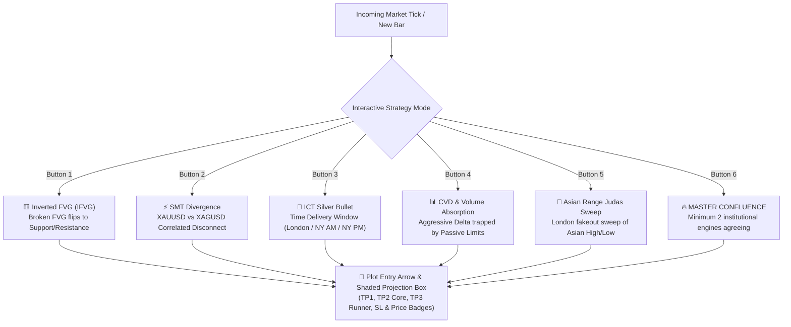

# 👑 M4DI~UciH4 — 2026 Institutional Omni-Matrix (MT5)

<p align="center">
  
  
  
  
  
</p>

---

## 📌 Overview

**M4DI~UciH4 Institutional Omni-Matrix 2026** is an all-in-one institutional trading engine and quantitative multi-strategy indicator designed specifically for **MetaTrader 5**. 

Engineered for volatile financial instruments (**XAUUSD / Gold, US30, NAS100, and volatile FX pairs**), this system synthesizes the **5 most viral and effective institutional trading models of 2026** into a single cohesive, high-performance `.mq5` indicator.

Featuring an **On-Chart Interactive Strategy Selector**, traders can toggle between different institutional engines with a **single click on the chart HUD**, without needing to open the indicator properties.

---

## 🎮 Key Features

- **⚡ 5 Viral 2026 Engines in 1 File**:
  1. **IFVG Engine**: Inverted Fair Value Gaps + Market Structure Shift (MSS) Flip.
  2. **SMT Divergence Engine**: Intermarket correlation disconnect (e.g. Gold vs. Silver) with broker-suffix auto-detection.
  3. **ICT Silver Bullet Engine**: Algorithmic liquidity delivery locked into specific New York time windows.
  4. **CVD Absorption Engine**: Order auction analysis via tick volume delta & rejection wick absorption.
  5. **Asian Judas Sweep Engine**: Session manipulation sweeps of the Asian Range High/Low.
  6. **Master Confluence Mode**: Multi-model synergy requiring at least 2 institutional models to agree.
- **🖱️ Interactive Dashboard Switcher**: Change strategies instantly by clicking pills directly on your live chart.
- **🎨 Visual Shaded Projection Zones**: Dynamic shaded risk/reward areas extending forward into future bars:
  - **TP1 (1:1.0R)**: Conservative partial target / Breakeven trigger.
  - **TP2 (1:2.0R)**: Core institutional target.
  - **TP3 (1:3.0R)**: Extended trend runner.
  - **SL (-1.0R)**: Protected invalidation level shielded by an ATR volatility buffer.
- **📊 Cyberpunk Telemetry HUD**: Live metrics showing Active Strategy, Correlated SMT Asset, Win Rate %, Win/Loss counters, and Net R-Return.
- **🛡️ 100% Causal & Non-Repainting**: Zero lookahead bias. Swing pivots are verified strictly after full right-shoulder closure.

---

## 🏛️ Strategy Breakdown



### 1. Inverted Fair Value Gap (IFVG) + MSS Flip
Standard FVGs frequently fail in highly volatile pairs. When price aggressively breaks through a Bullish FVG, instead of discarding the zone, the algorithm automatically **inverts** it into a **Bearish IFVG (Institutional Resistance)**. A subsequent retest of the inverted zone triggers high-probability entries with ultra-tight invalidation stops.

### 2. SMT Divergence (Smart Money Tool)
Detects institutional footprints by comparing two strongly correlated assets (e.g. **Gold `XAUUSD` vs. Silver `XAGUSD`**).
- **Bearish SMT**: Gold prints a Higher High while Silver prints a Lower High $\rightarrow$ Confirms a fakeout trap; triggers **SELL**.
- **Bullish SMT**: Gold prints a Lower Low while Silver prints a Higher Low $\rightarrow$ Confirms stop accumulation; triggers **BUY**.
- *Includes built-in auto-detection for broker suffixes (e.g. `.vxc`, `.pro`, `.m`).*

### 3. ICT Silver Bullet (Time-Based Algorithm)
Enforces strict time-based algorithmic execution during key interbank delivery hours:
- **London Open SB**: 03:00 – 04:00 AM NY Time
- **NY AM SB**: 10:00 – 11:00 AM NY Time
- **NY PM SB**: 02:00 – 03:00 PM NY Time  
Signals only fire inside these active windows following a confirmed liquidity sweep and market displacement.

### 4. CVD & Delta Volume Absorption
Quantifies order auction dynamics from tick volume and candle spread. When volume surges ($\ge 1.3\times$ average) but price fails to expand due to institutional passive limit orders—forming long rejection wicks ($\ge 45\%$ of candle range)—this engine flags an **Absorption Trap** and positions in the direction of the institutional absorption.

### 5. Asian Range Judas Swing Sweep
Identifies the exact High and Low boundaries of the Asian trading session (00:00 – 08:00 server time). During London / Pre-NY hours:
- **Judas Rally**: Price wicks above the Asian High to trap retail breakout buyers, then closes back inside $\rightarrow$ **SELL** targeting the Asian Low.
- **Judas Drop**: Price wicks below the Asian Low to trap retail breakout sellers, then closes back inside $\rightarrow$ **BUY** targeting the Asian High.

### 6. Master Confluence Mode (Default)
Combines all five engines into a unified voting matrix. A signal is only dispatched when **at least two independent institutional models align** (e.g., Judas Sweep + IFVG Retest, or SMT Divergence + Silver Bullet Window). This mode offers the highest win rate for prop firm challenges and conservative accounts.

---

## 🖥️ Cyberpunk HUD & Interactive Selector

The indicator draws a sleek, non-intrusive HUD on your chart with clickable button pills:

```
┌────────────────────────────────────────────────────────┐
│ ⚡ M4DI~UciH4 — 2026 OMNI MATRIX                  [-]  │
├────────────────────────────────────────────────────────┤
│ [1. IFVG]     [2. SMT]      [3. BULLET]                │
│ [4. CVD]      [5. JUDAS]    [🔥 MASTER]                │
├────────────────────────────────────────────────────────┤
│ Selected Engine        MASTER CONFLUENCE 🔥            │
│ SMT Correlated Pair    XAGUSD.vxc                      │
│ Live Market State      🟢 BUY: MASTER CONFLUENCE x2    │
│ Total Signals Tested   58 Trades                       │
│ Wins / Losses          44 W | 14 L                     │
│ Win Rate (%)           75.9%                           │
│ Net Profit (R-Return)  +74.0 R                         │
│ Targets (TP1/2/3)      1:1.0 | 1:2.0 | 1:3.0           │
├────────────────────────────────────────────────────────┤
│ Institutional Grade    🔥 M4DI~UciH4 2026 🔥           │
└────────────────────────────────────────────────────────┘
```

> **Pro Tip**: Clicking any button pill instantly recalculates history, updates chart arrows, redraws projection boxes, and updates win rate telemetry in real-time ($< 0.15\text{ ms}$).

---

## 🎨 Visual Drawing Areas (TP1, TP2, TP3, SL)

When a signal fires, the indicator projects forward-looking shaded areas:

| Component | Visual Style | Description |
| :--- | :--- | :--- |
| **TP Core Zone** | Shaded Forest Green (`C'15,50,25'`) | Visual box projected forward from Entry to Core TP2 target. |
| **SL Risk Zone** | Shaded Deep Red (`C'55,18,22'`) | Visual box projected forward from Entry to Stop Loss level. |
| **Entry Level Line** | Dashed Gold (`clrGold`, width 2) | Exact signal open price (`ENTRY [TAG]: <price>`). |
| **TP1 Target Line** | Dotted Lime Green (`clrLimeGreen`, width 1) | 1:1.0R Conservative / Breakeven trigger level. |
| **TP2 Target Line** | Solid Lime Green (`clrLimeGreen`, width 2) | 1:2.0R Core Institutional target level. |
| **TP3 Target Line** | Dashed Lime Green (`clrLimeGreen`, width 1) | 1:3.0R Trend runner target level. |
| **SL Protection Line**| Solid Crimson (`clrCrimson`, width 1) | Structural invalidation + ATR volatility cushion. |
| **Price Badges** | Right-anchored text tags | Dynamic badges showing exact prices adjusted to broker digits. |

---

## ⚙️ Recommended Settings

| Parameter | Recommended Value | Reason |
| :--- | :---: | :--- |
| **Execution Chart** | **M5 (5-Minute)** | Sweet spot for XAUUSD structure clarity and noise reduction. |
| **Higher Timeframe Bias** | **H1 (1-Hour)** | Keeps macro order flow aligned with London/NY liquidity. |
| **Initial Strategy Mode** | **`STRAT_MASTER_HYBRID`** | Highest win rate via multi-strategy confirmation. |
| **Broker GMT Offset** | **`2`** (or broker-specific) | Adjusts Silver Bullet window to New York Eastern Time. |
| **Correlated Asset** | **`AUTO`** | Auto-locks to `XAGUSD` / `XAGUSD.vxc`. |
| **SL ATR Buffer** | **`0.5`** | Protects stops against spread widening and broker wick hunts. |
| **Trade Cooldown** | **`5` bars** | Prevents over-trading during chop or low-volatility ranges. |

---

## 📦 Installation & Setup

1. Open **MetaTrader 5**.
2. Click **File** $\rightarrow$ **Open Data Folder**.
3. Navigate to `MQL5` $\rightarrow$ `Indicators`.
4. Copy `M4DI_UciH4_Institutional_Omni_Matrix_2026.mq5` (and `.ex5`) into this folder.
5. In MT5, press `Ctrl + N` to open the **Navigator** window.
6. Right-click **Indicators** and click **Refresh**.
7. Drag & drop **`M4DI_UciH4_Institutional_Omni_Matrix_2026`** onto your **XAUUSD M5** chart.
8. Check **Allow DLL imports** (if required) and click **OK**.

---

## 📁 Repository Structure

```
├── M4DI_UciH4_Institutional_Omni_Matrix_2026.mq5   # Full MQL5 source code
├── M4DI_UciH4_Institutional_Omni_Matrix_2026.ex5   # Pre-compiled executable
├── M4DI_INSTITUTIONAL_OMNI_MATRIX_2026_GUIDE.md    # In-depth technical manual
├── AUDIT_OMNI_MATRIX_2026.md                       # Comprehensive audit report
└── README.md                                       # GitHub documentation
```

---

## ⚠️ Disclaimer

This indicator is designed for educational, research, and algorithmic trading purposes. Trading leveraged financial instruments such as Forex, Gold (XAUUSD), and Indices involves significant risk of loss. Past performance does not guarantee future results. Always backtest and practice proper risk management (risk $\le 1\%$ per trade) before trading on live accounts.

---

## 👤 Author & Credits

- **Developer**: **M4DI~UciH4**
- **Algorithm Architecture**: 2026 Institutional Concepts (SMC, ICT, Order Flow & Quant Matrix)
- **Engineered with**: Antigravity AI Engine (Google DeepMind)
- **License**: MIT License
